# Информация

## Докладчик

:::::::::::::: {.columns align=center}
::: {.column width="70%"}

  * Калашникова Дарья Викторовна
  * Студент
  * Российский университет дружбы народов
  * [1132243108@pfur.ru](mailto:1132243108@pfur.ru)

:::
::: {.column width="30%"}

:::
::::::::::::::

## Цель работы

Освоение практических приёмов проектирования адресного плана для IPv4/IPv6 и настройки двойного стека (Dual Stack) на сетевом оборудовании

## Развёртывание топологии

В GNS3 была собрана схема сети. Все узлы переименованы с добавлением фамилии — `dvkalashnikova`

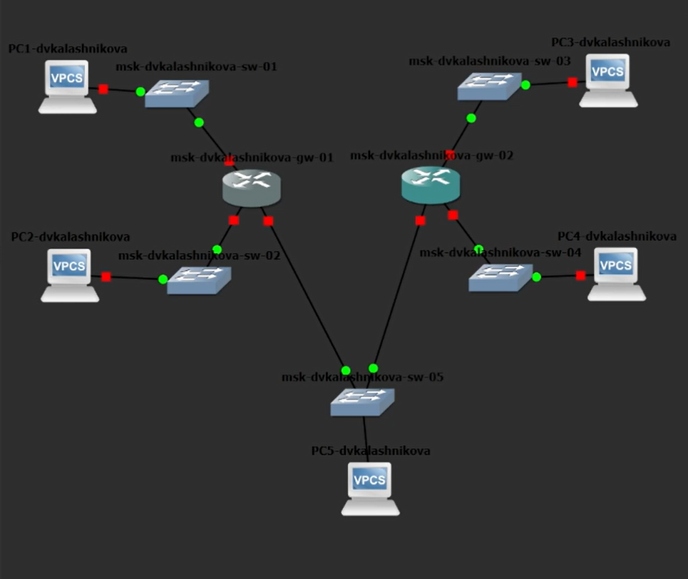{#fig-001 width=60%}

## Захват трафика

Был включён перехват пакетов на канале между сервером (`PC5-dvkalashnikova`) и коммутатором (`msk-dvkalashnikova-sw-05`)

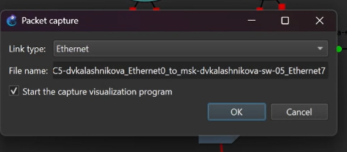{#fig-002 width=60%}

## Настройка IPv4 на PC1

Назначен адрес `172.16.20.10/25` со шлюзом `172.16.20.1`

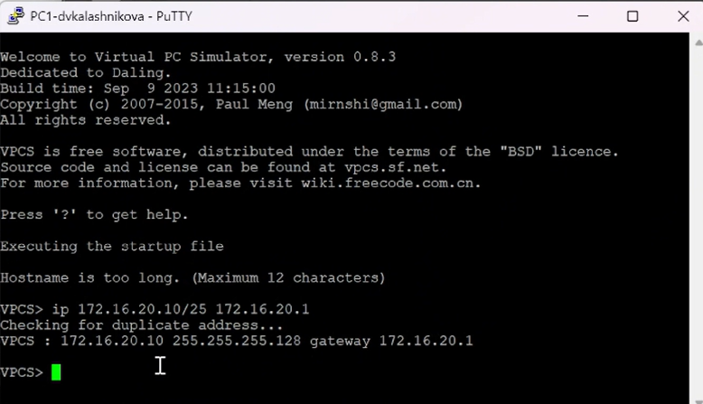{#fig-003 width=60%}

## Настройка IPv4 на PC2

Установлен IP `172.16.20.138/25`, шлюз `172.16.20.129`

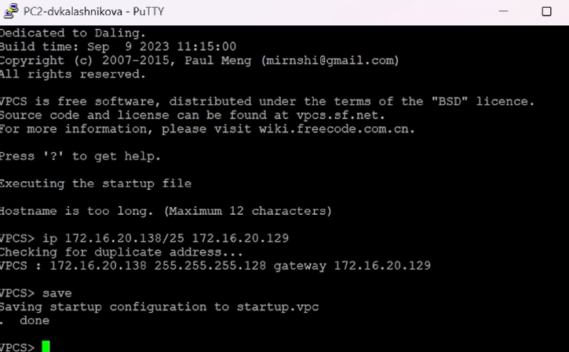{#fig-004 width=60%}

## Настройка IPv4 на сервере

Для устройства `PC5` задан адрес `64.100.1.10/24` и шлюз `64.100.1.1`

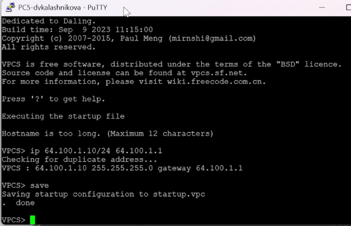{#fig-005 width=60%}

## Проверка IPv4 на PC1

Конфигурация подтверждена: `172.16.20.10/25`, шлюз указан верно

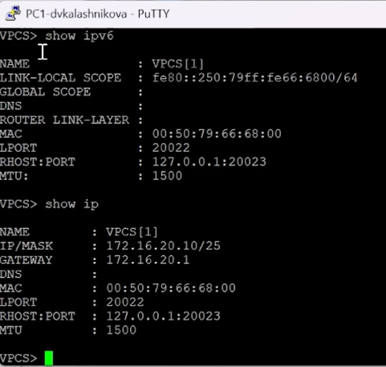{#fig-006 width=60%}

## Проверка IPv4 на PC2

Узел получил адрес `172.16.20.138/25`

{#fig-007 width=60%}

## Настройка маршрутизатора FRR

Настроены IP-адреса на интерфейсах `eth0`, `eth1` и `eth2`. Интерфейсы активированы

{#fig-008 width=60%}

## Проверка конфигурации FRR

Через `show running-config` подтверждено, что все три интерфейса получили свои адреса

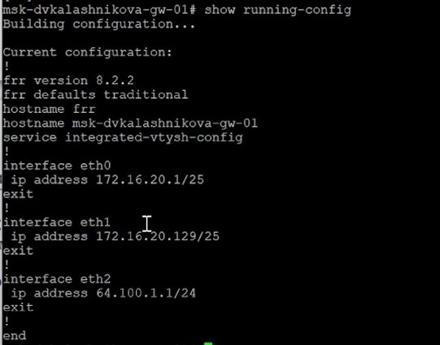{#fig-009 width=60%}

## Статус интерфейсов FRR

Команда `show interface brief` показала, что все интерфейсы в состоянии `UP`

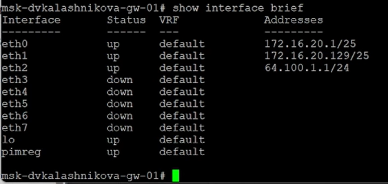{#fig-010 width=60%}

## Проверка IPv4-связности

С PC1 отправлены эхо-запросы и трассировка до PC2. Всё отработало без ошибок

{#fig-011 width=60%}

## Доступность сервера

С PC1 выполнены `ping` и `trace` до `64.100.1.10` — пакеты успешно прошли через шлюз

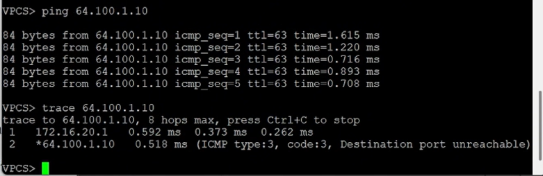{#fig-012 width=60%}

## Настройка IPv6 на PC3

Задан глобальный адрес `2001:db8:c0de:12::a/64`

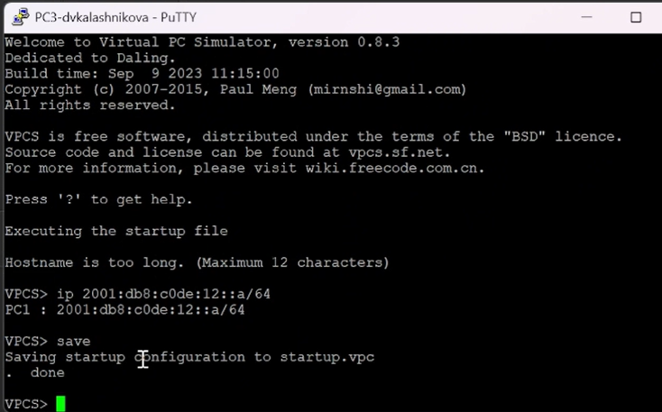{#fig-013 width=60%}

## Настройка IPv6 на PC4

Прописан адрес `2001:db8:c0de:13::a/64`

{#fig-014 width=60%}

## Настройка IPv6 на сервере

Серверу `PC5` присвоен IPv6-адрес `2001:db8:c0de:11::a`

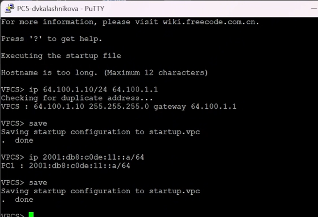{#fig-015 width=60%}

## Проверка IPv6 на PC3

Устройство получило глобальный адрес `2001:db8:c0de:12::a/64`

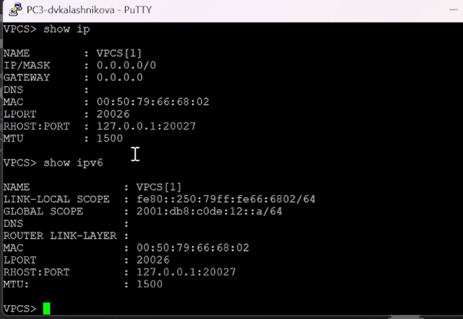{#fig-016 width=60%}

## Проверка IPv6 на PC4

Интерфейс получил `2001:db8:c0de:13::a/64`

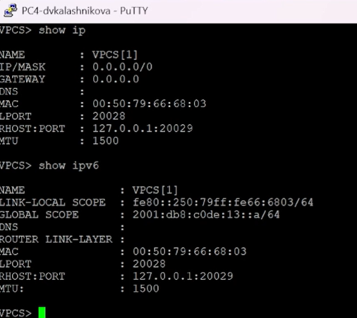{#fig-017 width=60%}

## Настройка VyOS

Маршрутизатору `msk-dvkalashnikova-gw-02` изменено имя хоста и сохранены настройки

{#fig-018 width=60%}

## IPv6 и Router Advertisement

Настроены IPv6-адреса на интерфейсах и включена служба `router-advert` для рассылки префиксов

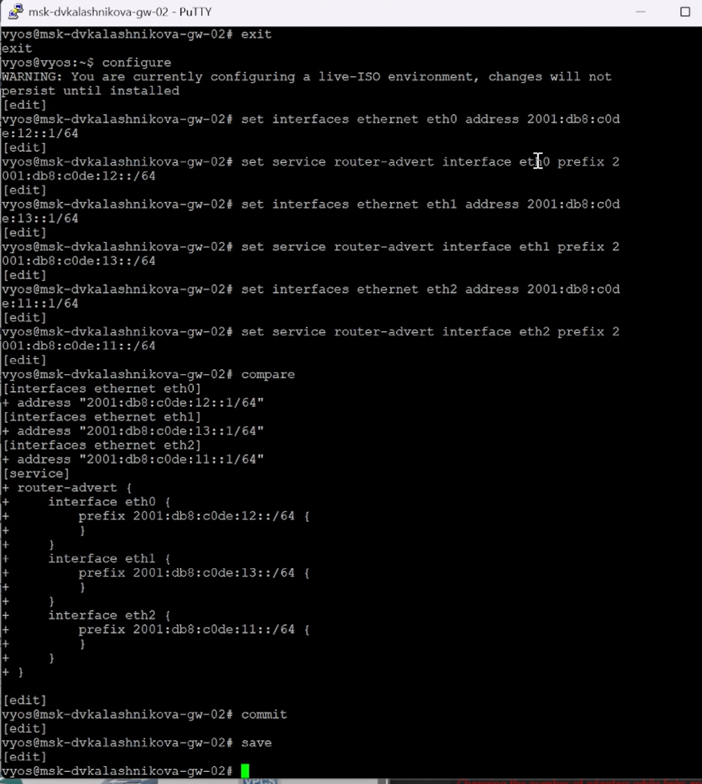{#fig-019 width=60%}

## Проверка интерфейсов VyOS

Команда `show interfaces` подтвердила корректное применение IPv6-адресов

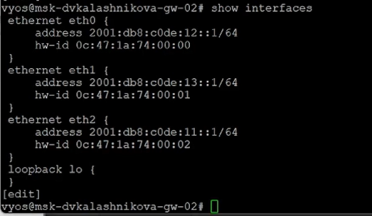{#fig-020 width=60%}

## IPv6-связность

С PC3 отправлены эхо-запросы и трассировка до PC4. Маршрутизация работает

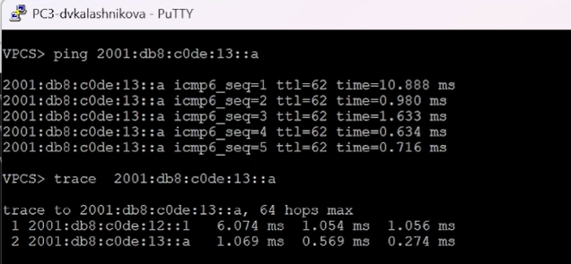{#fig-021 width=60%}

## Доступность сервера по IPv6

С PC3 прошли успешные пакеты до IPv6-адреса сервера

{#fig-022 width=60%}

## Режим Dual Stack: PC1

Пинг до IPv4-адреса сервера прошёл, а до IPv6 — завершился неудачей. Ожидаемое поведение для чистого IPv4

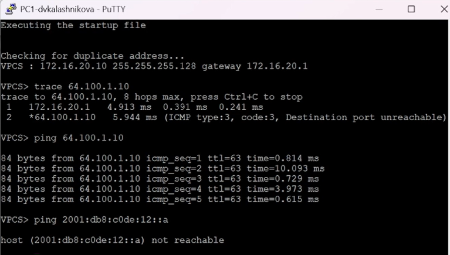{#fig-023 width=60%}

## Режим Dual Stack: PC3

Попытка пинга IPv4-адреса с IPv6-узла завершилась ошибкой `host not reachable`

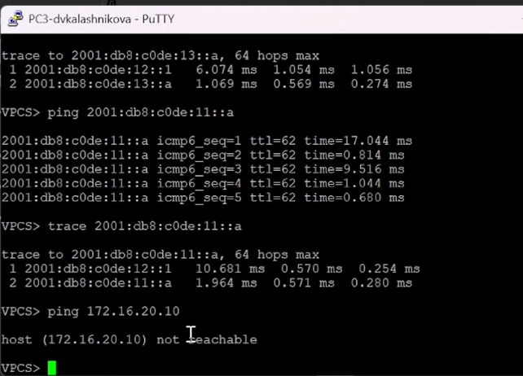{#fig-024 width=60%}

## Работа сервера

Сервер успешно пингует как IPv4, так и IPv6 узлы — Dual Stack работает

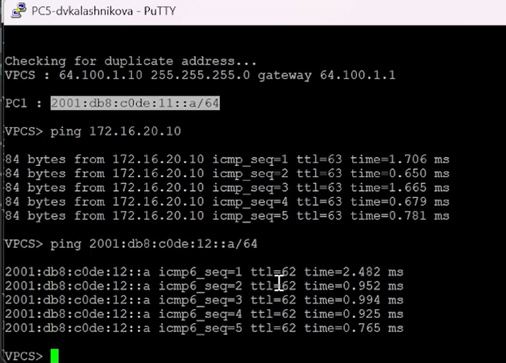{#fig-025 width=60%}

## Анализ трафика IPv4

В Wireshark видны пакеты ICMP и ARP для IPv4

{#fig-026 width=60%}

## Анализ трафика IPv6

Видны пакеты ICMPv6 и сообщения Neighbor Discovery (аналог ARP для IPv6)

{#fig-027 width=60%}

## Детали пакетов IPv4

Последовательность ICMP-пакетов между узлами

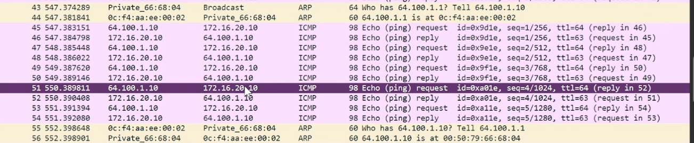{#fig-028 width=60%}

## Детали пакетов IPv6

Аналогичная картина для IPv6-пакетов

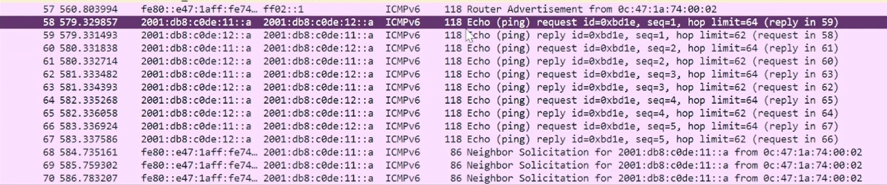{#fig-029 width=60%}

## Самостоятельная работа: расчёт

Для первой подсети: `10.10.1.96/27` (30 узлов), `2001:DB8:1:1::/64`. Для второй: `10.10.1.16/28` (14 узлов), `2001:DB8:1:4::/64`

{#fig-030 width=60%}

## Топология

Два ПК подключены через коммутаторы к маршрутизатору VyOS

{#fig-031 width=60%}

## Настройка PC1 и PC2

Прописаны рассчитанные адреса IPv4 и IPv6, указаны шлюзы

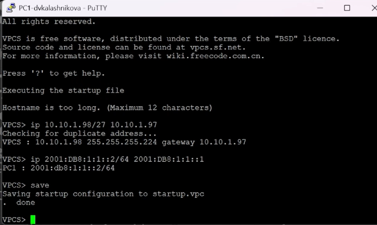{#fig-032 width=60%}

{#fig-033 width=60%}

## Ошибка при commit

На `eth0` работал DHCP-клиент, который конфликтовал со статическим адресом

{#fig-034 width=60%}

## Исправление конфигурации

После удаления DHCP (командой `del interfaces ethernet eth0 address dhcp`) изменения применились. Проверка через `show interfaces` подтвердила настройки

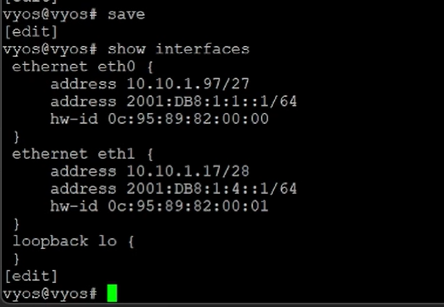{#fig-035 width=60%}

## Router Advertisement

Включён `router-advert` на `eth0` и `eth1` для рассылки IPv6-префиксов

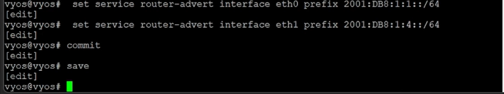{#fig-036 width=60%}

## Проверка с PC1

С PC1 успешно пропингованы PC2 как по IPv4 (`10.10.1.18`), так и по IPv6 (`2001:DB8:1:4::2`)

{#fig-037 width=60%}

## Проверка с PC2

Обратная проверка с PC2 показала успешное прохождение пакетов

{#fig-038 width=60%}

## Выводы

Освоены составление таблиц адресации, разбиение сетей на подсети, настройка FRR и VyOS, конфигурирование сервера с двойным стеком. Изучен протокол ICMPv6 и механизм Dual Stack

## Список литературы

1. IETF. RFC 791: Internet Protocol [Электронный ресурс]. — URL: https://datatracker.ietf.org/doc/html/rfc791

2. IETF. RFC 4632: Classless Inter-domain Routing (CIDR) [Электронный ресурс]. — URL: https://datatracker.ietf.org/doc/html/rfc4632

3. IETF. RFC 4291: IP Version 6 Addressing Architecture [Электронный ресурс]. — URL: https://datatracker.ietf.org/doc/html/rfc4291

4. IETF. RFC 4193: Unique Local IPv6 Unicast Addresses [Электронный ресурс]. — URL: https://datatracker.ietf.org/doc/html/rfc4193

5. Red Hat. Documentation [Электронный ресурс]. — URL: https://docs.redhat.com/
