# Цель работы

Освоение практических приёмов проектирования адресного плана для IPv4/IPv6 и настройки двойного стека (Dual Stack) на сетевом оборудовании.

# Выполнение практической части

## Развёртывание топологии

В GNS3 была собрана схема сети. В соответствии с требованиями все узлы были переименованы с добавлением фамилии — `dvkalashnikova`.

{#fig:001}

Затем был включён перехват трафика на канале, соединяющем серверный узел (`PC5-dvkalashnikova`) с ближайшим коммутатором (`msk-dvkalashnikova-sw-05`). Это требуется для дальнейшего детального анализа пакетов.

{#fig:002}

## Настройка IPv4-адресации

Первым делом была настроена IPv4-адресация на узле `PC1`: назначен адрес `172.16.20.10/25` со шлюзом `172.16.20.1`.

{#fig:003}

Аналогичным образом сконфигурирован `PC2`. На него установлен IP `172.16.20.138/25`, а в качестве шлюза указан `172.16.20.129`.

{#fig:004}

Для сервера (устройство `PC5`) также прописаны IPv4-параметры: адрес `64.100.1.10/24` и шлюз `64.100.1.1`.

{#fig:005}

После этого была проверена конфигурация `PC1` через консоль. Утилита подтвердила, что узлу присвоен `172.16.20.10/25` и указан верный шлюз.

{#fig:006}

Такая же проверка прошла успешно и на `PC2` — узел получил свой адрес `172.16.20.138/25`.

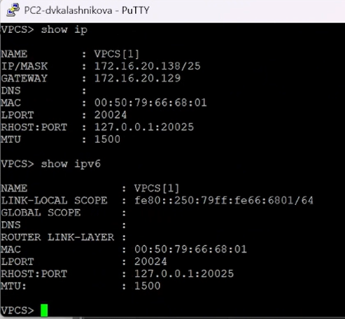{#fig:007}

## Настройка маршрутизатора FRR

Следующим шагом стала настройка маршрутизатора FRR (`msk-dvkalashnikova-gw-01`). Были прописаны IP-адреса для интерфейсов `eth0`, `eth1` и `eth2` и активированы их командой `no shutdown`.

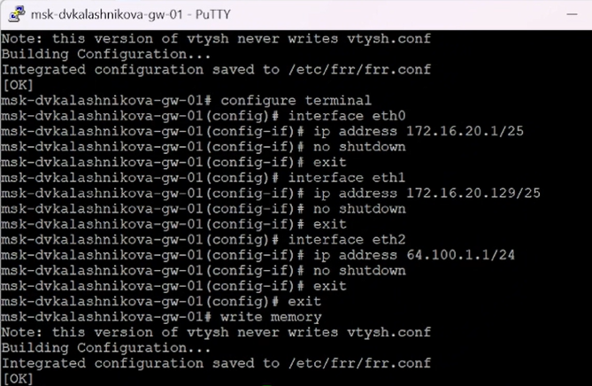{#fig:008}

Чтобы убедиться в правильности действий, была выведена текущая конфигурация через `show running-config`. Все три интерфейса получили свои адреса.

{#fig:009}

Дополнительно проверен статус портов через `show interface brief`. Команда показала, что `eth0`, `eth1` и `eth2` находятся в состоянии `UP`.

{#fig:010}

## Проверка IPv4-связности

Далее была проверена связность внутри IPv4-сегмента. С `PC1` отправлены эхо-запросы и трассировка до `PC2` (`172.16.20.138`). Всё отработало без ошибок.

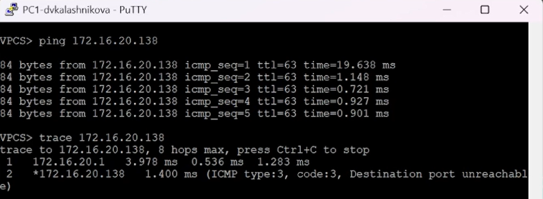{#fig:011}

Затем проверена доступность сервера из IPv4-подсети. С `PC1` выполнены `ping` и `trace` до адреса `64.100.1.10` — пакеты успешно ушли через шлюз.

{#fig:012}

## Настройка IPv6-адресации

После IPv4 началась адресация второй подсети (IPv6). На `PC3` задан глобальный адрес `2001:db8:c0de:12::a/64`.

{#fig:013}

Для `PC4` прописан адрес `2001:db8:c0de:13::a/64`.

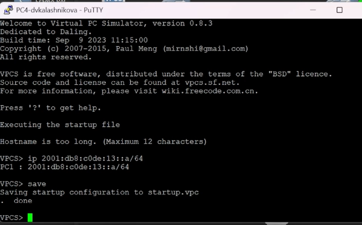{#fig:014}

Серверу (устройство `PC5`) присвоен IPv6-адрес `2001:db8:c0de:11::a`.

{#fig:015}

Затем проверены настройки на `PC3` — устройство успешно получило глобальный адрес `2001:db8:c0de:12::a/64`.

{#fig:016}

Такая же проверка проведена на `PC4`. Его интерфейс получил `2001:db8:c0de:13::a/64`.

{#fig:017}

## Настройка маршрутизатора VyOS

Затем началась настройка маршрутизатора `msk-dvkalashnikova-gw-02` на базе ОС VyOS. Было изменено имя хоста и сохранены изменения.

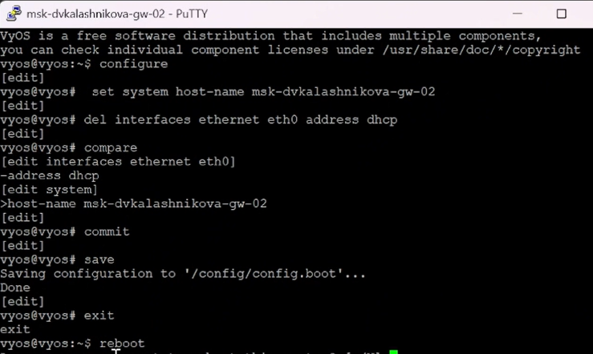{#fig:018}

Далее настроены IPv6-адреса на интерфейсах `eth0`, `eth1` и `eth2`, а также включена служба `router-advert` для рассылки префиксов. Все изменения зафиксированы в конфигурации.

{#fig:019}

Команда `show interfaces` подтвердила, что IPv6-адреса применились корректно.

{#fig:020}

## Проверка IPv6-связности

Далее протестирована IPv6-связность между устройствами. С `PC3` отправлены эхо-запросы и трассировка до `PC4`. Маршрутизация отработала верно.

{#fig:021}

Затем проверена доступность сервера по IPv6. С `PC3` прошли успешные пакеты до IPv6-адреса сервера.

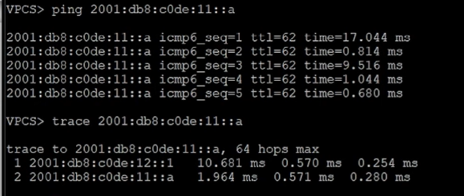{#fig:022}

## Проверка режима Dual Stack

Интересный момент обнаружился при проверке со стороны IPv4 (с `PC1`). Пинг и трассировка до IPv4-адреса сервера прошли успешно, а попытка обратиться к IPv6-адресу завершилась неудачей — это ожидаемо, так как чисто IPv4-устройство не может общаться с IPv6 напрямую.

{#fig:023}

Попытка пингануть IPv4-адрес с IPv6-узла (`PC3`) также завершилась ошибкой `host not reachable`. Это ещё раз подтвердило изоляцию протоколов без двойного стека.

{#fig:024}

При этом сервер отлично видит обе сети, так как он работает в режиме Dual Stack (пингует и IPv4, и IPv6 узлы).

{#fig:025}

## Анализ трафика в Wireshark

После этого был проанализирован трафик в Wireshark. В захвате видны пакеты ICMP и ARP для IPv4.

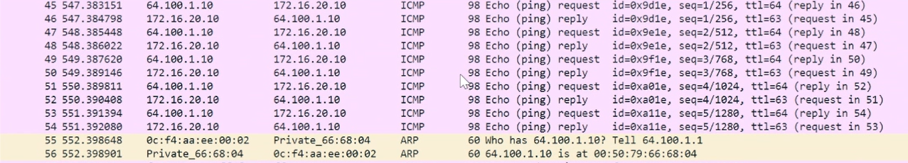{#fig:026}

А для IPv6 видны пакеты ICMPv6 (Echo Request/Reply) и сообщения Neighbor Discovery, которые выполняют роль ARP.

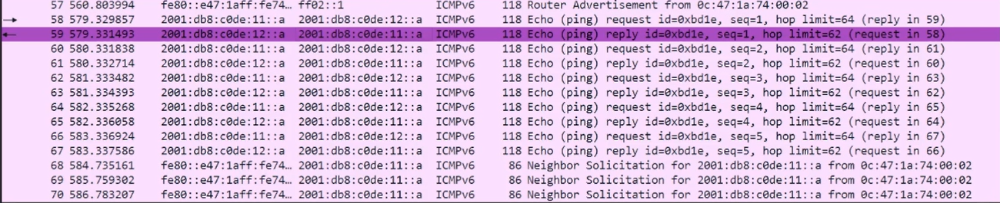{#fig:027}

В детальном просмотре можно увидеть последовательность пакетов для IPv4.

{#fig:028}

И аналогичную картину для IPv6-пакетов.

{#fig:029}

# Самостоятельная работа

В самостоятельном задании требовалось спроектировать сеть из двух подсетей с маршрутизатором VyOS и настроить двойной стек (IPv4/IPv6).

## Задача 1. Расчёт подсетей

**Дано:** две пары подсетей для IPv4 и IPv6. Для первой выделены `10.10.1.96/27` и `2001:DB8:1:1::/64`, для второй — `10.10.1.16/28` и `2001:DB8:1:4::/64`.

### Характеристики первой подсети (IPv4)

**Префикс:** 27

**Маска:** `255.255.255.224` (в двоичном виде: `11111111.11111111.11111111.11100000`).

**Шаг сети:** 32 (2^5 = 32 адреса в блоке).

**Адрес сети:** `10.10.1.96`

**Broadcast-адрес:** `10.10.1.127`

**Диапазон узлов:** `10.10.1.97 – 10.10.1.126` (всего 30 узлов).

### Характеристики второй подсети (IPv4)

**Префикс:** 28

**Маска:** `255.255.255.240` (в двоичном виде: `11111111.11111111.11111111.11110000`).

**Шаг сети:** 16 (2^4 = 16 адресов в блоке).

**Адрес сети:** `10.10.1.16`

**Broadcast-адрес:** `10.10.1.31`

**Диапазон узлов:** `10.10.1.17 – 10.10.1.30` (всего 14 узлов).

### IPv6-подсети

Для первой подсети выделена сеть `2001:DB8:1:1::/64`, для второй — `2001:DB8:1:4::/64`. В IPv6 нет широковещательных адресов, поэтому адреса раздаются начиная с `::1` и заканчиваются `::ffff:ffff:ffff:ffff`.

## Задача 2. Таблица адресации

**Дано:** интерфейсам маршрутизатора нужно выдать наименьшие адреса в подсетях.

По условию, для первой подсети выбраны `10.10.1.97` и `2001:DB8:1:1::1`, для второй — `10.10.1.17` и `2001:DB8:1:4::1`.

Оконечным устройствам достаются следующие адреса: для `PC1` это `.98` и `::2`, для `PC2` — `.18` и `::2` соответственно. Шлюзом для каждого ПК выступает соответствующий интерфейс маршрутизатора.

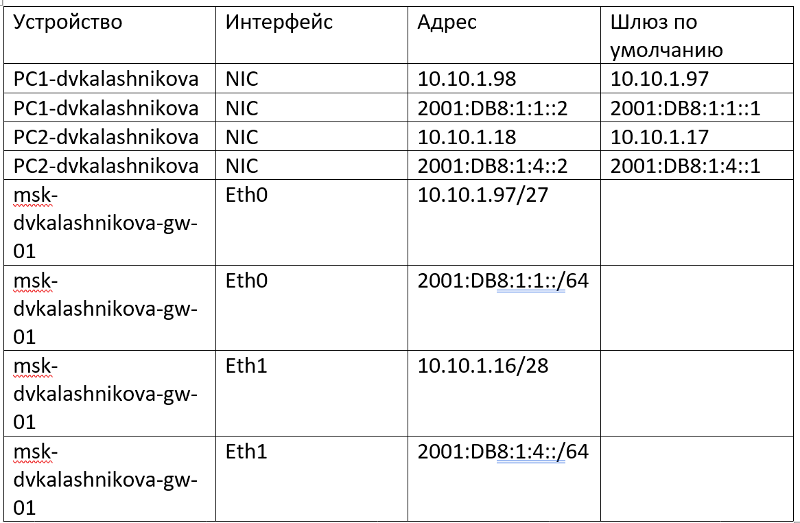{#fig:030}

## Задача 3. Настройка устройств

В GNS3 была собрана топология: два ПК подключены через коммутаторы к маршрутизатору VyOS.

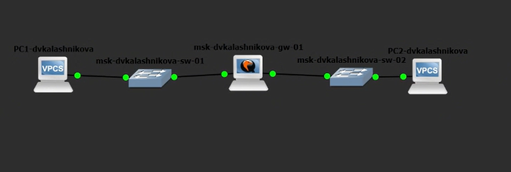{#fig:031}

На `PC1` и `PC2` были прописаны рассчитанные адреса и шлюзы.

{#fig:032}

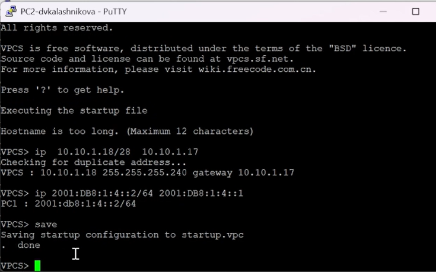{#fig:033}

При настройке самого маршрутизатора произошёл сбой при попытке выполнить `commit`. Причина была в том, что на интерфейсе `eth0` по умолчанию работал DHCP-клиент, который конфликтовал со статическим адресом.

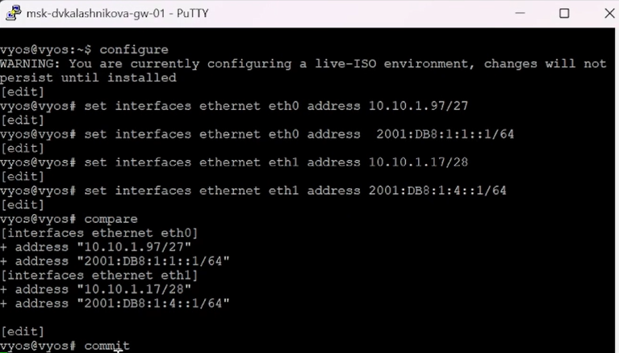{#fig:034}

Чтобы решить проблему, настройка DHCP была удалена командой `del interfaces ethernet eth0 address dhcp`. После этого `commit` прошёл успешно. Команда `show interfaces` подтвердила, что IPv4 и IPv6 адреса встали как надо.

{#fig:035}

Также был включён `router-advert` на `eth0` и `eth1`, чтобы рассылать IPv6-префиксы в локальные сети.

{#fig:036}

## Задача 4. Проверка связности

Финальная проверка проводилась командами `ping` и `trace`.

С `PC1` успешно пропингованы `PC2` как по IPv4 (`10.10.1.18`), так и по IPv6 (`2001:DB8:1:4::2`). Трассировка показала, что трафик идёт через шлюз.

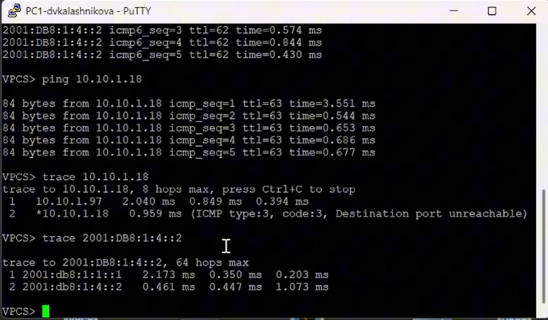{#fig:037}

Обратная проверка с `PC2` тоже прошла успешно — пакеты доходят до маршрутизатора и возвращаются, что говорит о корректной настройке маршрутизации.

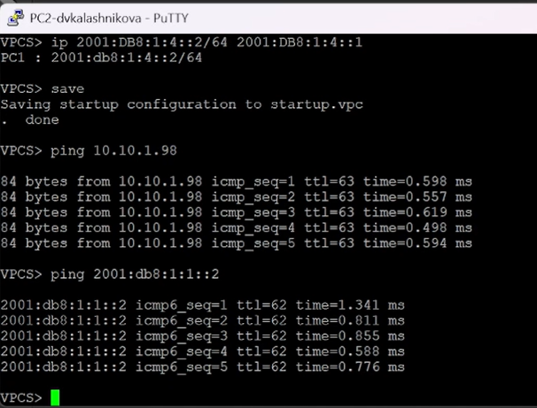{#fig:038}

# Выводы

В ходе работы были освоены составление таблиц адресации, разбиение сетей на подсети, настройка оборудования (FRR и VyOS) и конфигурирование сервера с двойным стеком. Также на практике изучено, как работает протокол ICMPv6 и механизм Dual Stack.

# Список литературы {.unnumbered}

1. IETF. RFC 791: Internet Protocol [Электронный ресурс]. — URL: https://datatracker.ietf.org/doc/html/rfc791 (дата обращения: 07.10.2026).

2. IETF. RFC 4632: Classless Inter-domain Routing (CIDR) [Электронный ресурс]. — URL: https://datatracker.ietf.org/doc/html/rfc4632 (дата обращения: 07.10.2026).

3. IETF. RFC 4291: IP Version 6 Addressing Architecture [Электронный ресурс]. — URL: https://datatracker.ietf.org/doc/html/rfc4291 (дата обращения: 07.10.2026).

4. IETF. RFC 4193: Unique Local IPv6 Unicast Addresses [Электронный ресурс]. — URL: https://datatracker.ietf.org/doc/html/rfc4193 (дата обращения: 07.10.2026).

5. Red Hat. Documentation [Электронный ресурс]. — URL: https://docs.redhat.com/ (дата обращения: 07.10.2026).
