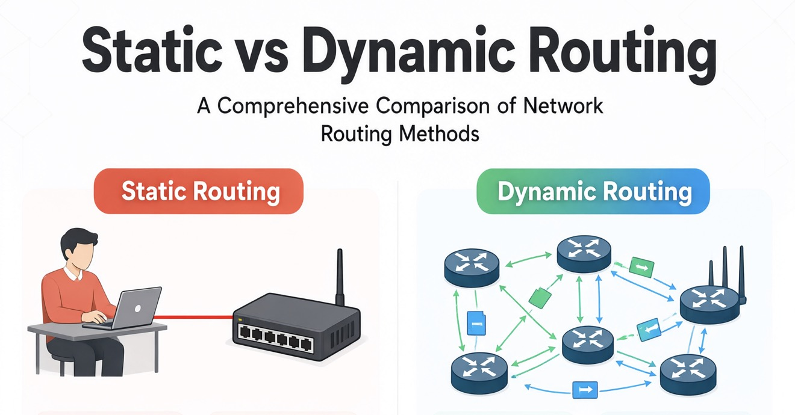
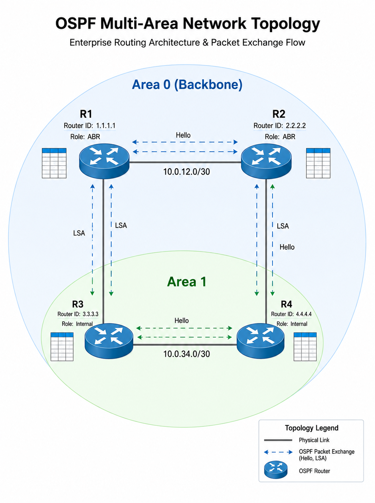

## Докладчик

:::::::::::::: {.columns align=center}
::: {.column width="70%"}
  * Калашникова Дарья Викторовна
  * Студент
  * Российский университет дружбы народов
  * [1132243108@pfur.ru]
:::
::: {.column width="30%"}

:::
::::::::::::::

## Цель доклада

Рассмотреть принципы **статической** и **динамической** маршрутизации в IP-сетях: назначение, принцип работы, основные протоколы, преимущества и недостатки, а также сценарии применения в современных сетях.

Для этого решаются следующие задачи:

- разобрать механизм статической маршрутизации и её ограничения;

- изучить протоколы динамической маршрутизации (RIP, OSPF, BGP, EIGRP);

- сравнить оба подхода и выработать рекомендации по выбору.

## Что такое маршрутизация

**Маршрутизация** — это процесс выбора пути для передачи пакетов в сети. Каждый маршрутизатор принимает решение на основе **таблицы маршрутизации**, где для каждой сети назначения указан следующий хоп (next hop) или интерфейс выхода.

Существует два принципиально разных подхода к формированию этой таблицы:

- **Статическая маршрутизация** — маршруты задаются вручную администратором и не меняются до тех пор, пока их не изменят.

- **Динамическая маршрутизация** — маршруты автоматически изучаются с помощью протоколов и перестраиваются при изменении топологии.

## Что такое маршрутизация

{width=85%}

## Статическая маршрутизация: принцип и настройка

**Принцип:** маршрут прописывается вручную и не меняется автоматически.

**Пример (Linux):**
```bash
ip route add 192.168.2.0/24 via 192.168.1.1
```

**Пример (Cisco IOS):**
```text
ip route 192.168.2.0 255.255.255.0 192.168.1.1
```

**Особенности:**

- Не требует протоколов и служебного трафика.

- Не расходует CPU и полосу.

- **Не реагирует** на обрыв канала — пакеты теряются.

## Метрики статической маршрутизации

В статике метрика задаётся вручную. Она нужна для выбора между несколькими маршрутами и приоритезации.

- **Административное расстояние (AD)** — «вес» источника маршрута. У статики AD = 1 (по умолчанию), поэтому она приоритетнее OSPF (110) и RIP (120).

- **Floating static** — резервный статический маршрут с высоким AD (например, 200). Активируется только при отказе основного маршрута.

**Пример (Cisco IOS):**
```text
ip route 0.0.0.0 0.0.0.0 203.0.113.1 200
```

## Динамическая маршрутизация: принцип

**Принцип:** маршрутизаторы обмениваются служебной информацией и автоматически строят таблицы. При изменении топологии таблицы перестраиваются без участия администратора.

**Основные протоколы:**

- **RIP** — Distance Vector, устаревший, метрика — число хопов;

- **OSPF** — Link-State, стандарт корпоративных сетей, метрика — стоимость канала;

- **BGP** — Path Vector, основа маршрутизации в Интернете;

- **EIGRP** — гибридный, проприетарный протокол Cisco.

## Динамическая маршрутизация: принцип

{width=30%}

## Основные протоколы динамической маршрутизации

Выбор протокола зависит от размера сети, требований к скорости сходимости и совместимости с оборудованием.

| Протокол | Тип | Метрика | Применение |
|---|---|---|---|
| **RIP** | Distance Vector | Хопы (макс. 15) | Малые сети |
| **OSPF** | Link-State | Стоимость канала | Корпоративные сети |
| **EIGRP** | Гибридный | Композитная | Cisco-сети |
| **BGP** | Path Vector | Атрибуты пути | Интернет / AS |

## Метрики динамической маршрутизации

**Метрика** — это «стоимость» маршрута. Протоколы используют разные метрики для выбора лучшего пути:

- **RIP** — число хопов. Максимум 15, 16 — «бесконечность».

- **OSPF** — стоимость канала: `10^8 / bandwidth`. Чем выше пропускная способность, тем ниже стоимость.

- **EIGRP** — композитная метрика: пропускная способность, задержка, надёжность, нагрузка.

- **BGP** — атрибуты пути: AS-path, local preference, MED и другие.

## Сравнение: статическая vs динамическая

| Критерий | Статическая | Динамическая |
|---|---|---|
| **Настройка** | Вручную | Автоматически |
| **Реакция на сбои** | Нет | Есть |
| **Нагрузка на CPU** | Минимальная | Зависит от протокола |
| **Масштабируемость** | Плохая | Высокая |
| **Безопасность** | Выше (нет обмена) | Требует аутентификации |
| **Применение** | Малые сети, stub-сети | Крупные сети, Интернет |

## Типичные ошибки

**Статическая маршрутизация:**

1. **Нет обратного маршрута** — ответы не возвращаются.

2. **Опечатка в маске** — маршрут не работает.

3. **Статика при частых изменениях** — простои.

**Динамическая маршрутизация:**

1. **Нет аутентификации** — риск подмены маршрутов.

2. **Неверные таймеры** — flapping.

3. **Конфликт протоколов** (OSPF и RIP) — непредсказуемое поведение.

## Рекомендации по выбору

**Статическая маршрутизация:**

- Малые сети (до 10–15 маршрутизаторов).

- Stub-сети (с одним выходом во внешний мир).

- Резервные маршруты (floating static) с более высокой метрикой.

**Динамическая маршрутизация:**

- Крупные корпоративные сети.

- Сети с резервированием каналов.

- Интернет-провайдеры (BGP).

**Гибридный подход:** статика для default route, динамика — для внутренней сети.

## Выводы

Маршрутизация — основа работы IP-сетей.

**Статическая** маршрутизация проста и надёжна для небольших сетей, но не масштабируется и не адаптируется к сбоям.

**Динамическая** маршрутизация обеспечивает автоматическое восстановление и масштабируемость, но требует настройки протоколов, аутентификации и ресурсов.

Выбор зависит от размера сети, требований к отказоустойчивости и квалификации администратора.

## Источники

1. **Tanenbaum A., Wetherall D.** Computer Networks. — 5th ed. — Pearson, 2011. (дата обращения: 19.11.2026)
2. **RFC 1058.** Routing Information Protocol. — IETF. — URL: https://datatracker.ietf.org/doc/html/rfc1058 (дата обращения: 19.11.2026)
3. **RFC 2328.** OSPF Version 2. — IETF. — URL: https://datatracker.ietf.org/doc/html/rfc2328 (дата обращения: 19.11.2026)
4. **RFC 4271.** A Border Gateway Protocol 4 (BGP-4). — IETF. — URL: https://datatracker.ietf.org/doc/html/rfc4271 (дата обращения: 19.11.2026)
5. **Куроуз Дж., Росс К.** Компьютерные сети. — 6-е изд. — СПб.: Питер, 2020. (дата обращения: 19.11.2026)
