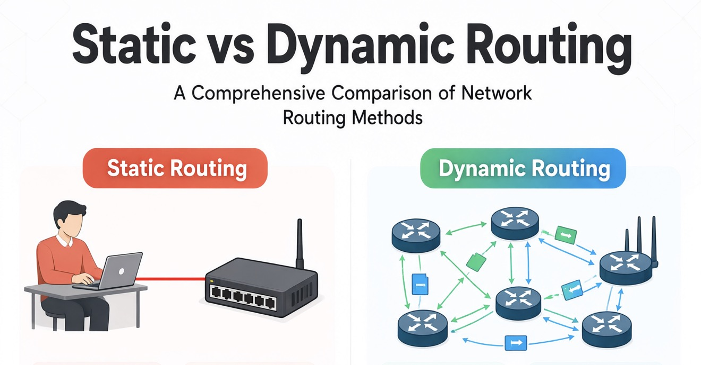
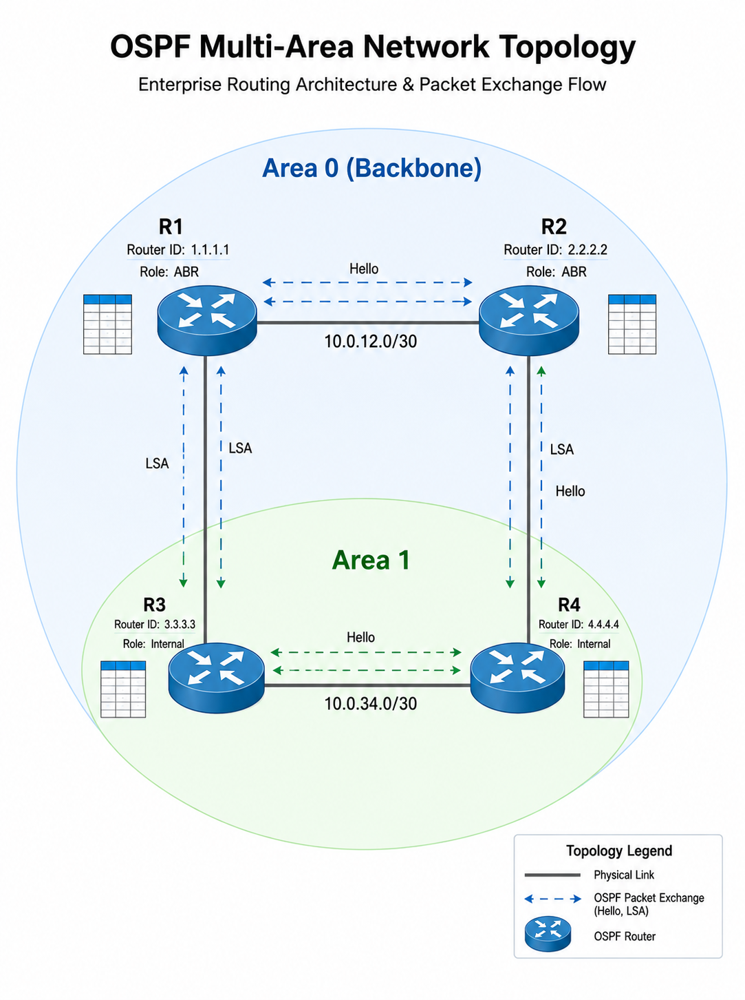

# Введение

Маршрутизация — это фундаментальный процесс, лежащий в основе работы любой IP-сети. Без неё пакеты не смогли бы находить путь от отправителя к получателю через множество промежуточных устройств. В современных сетях, будь то небольшая офисная локальная сеть или глобальная инфраструктура Интернета, маршрутизаторы принимают решения о передаче пакетов на основе таблиц маршрутизации. Эти таблицы могут формироваться двумя принципиально разными способами: вручную администратором (статическая маршрутизация) или автоматически с помощью специальных протоколов (динамическая маршрутизация).

**Актуальность** темы обусловлена тем, что выбор между статической и динамической маршрутизацией — это не просто техническая деталь, а стратегическое решение, влияющее на надёжность, масштабируемость и безопасность сети. Ошибка в выборе подхода может привести к простоям, уязвимостям или неоправданным затратам на администрирование. Поэтому понимание принципов работы обоих подходов, их преимуществ и ограничений является обязательным для любого сетевого инженера.

**Цель работы** — рассмотреть принципы статической и динамической маршрутизации в IP-сетях: их назначение, принцип работы, основные протоколы, преимущества и недостатки, а также сценарии применения в современных сетях.

**Задачи:**

1. Разобрать механизм статической маршрутизации и её ограничения.
2. Изучить протоколы динамической маршрутизации (RIP, OSPF, BGP, EIGRP).
3. Сравнить оба подхода и выработать рекомендации по выбору.

# Основы маршрутизации

**Маршрутизация** — это процесс выбора пути для передачи пакетов в сети. Каждый маршрутизатор принимает решение на основе **таблицы маршрутизации** (routing table), где для каждой сети назначения указан следующий хоп (next hop) — адрес соседнего маршрутизатора, которому нужно передать пакет, или интерфейс выхода [1, гл. 5].

Таблица маршрутизации может содержать маршруты нескольких типов:

- **Connected** — сети, напрямую подключённые к интерфейсам маршрутизатора. Они всегда имеют приоритет.
- **Статические** — маршруты, заданные администратором вручную [2].
- **Динамические** — маршруты, изученные с помощью протоколов маршрутизации [3].

Если в таблице есть несколько маршрутов к одной и той же сети, маршрутизатор выбирает лучший на основе метрики или административного расстояния (administrative distance, AD). Чем меньше AD, тем более «доверенным» считается источник маршрута [1, гл. 5].

## Как работает таблица маршрутизации

Таблица маршрутизации — это база данных, которая хранится в оперативной памяти маршрутизатора. Каждая запись в таблице содержит:

- **Сеть назначения** (destination network) — IP-адрес сети и маску подсети.
- **Следующий хоп** (next hop) — IP-адрес соседнего маршрутизатора, которому нужно передать пакет.
- **Интерфейс выхода** (outgoing interface) — физический или логический интерфейс, через который пакет покинет маршрутизатор.
- **Метрику** (metric) — «стоимость» маршрута, используемая для выбора лучшего пути.
- **Административное расстояние** (AD) — «вес» источника маршрута.

При поступлении пакета маршрутизатор просматривает таблицу и ищет наиболее специфичное совпадение (longest prefix match). Например, если есть маршруты к сетям `192.168.0.0/16` и `192.168.1.0/24`, пакет для адреса `192.168.1.5` будет отправлен по маршруту `/24`, потому что он более специфичен.

# Статическая маршрутизация

## Принцип работы

**Статическая маршрутизация** предполагает, что администратор вручную прописывает маршруты в таблицу. Маршрут остаётся неизменным до тех пор, пока его не изменят вручную [2]. Это означает, что при изменении топологии сети (например, при обрыве канала) маршрут не перестроится автоматически — пакеты будут теряться, пока администратор не внесёт исправления (рис. [-@fig:002]).

{#fig:002}

Статические маршруты задаются с помощью команд операционной системы или оборудования. Пример для Linux:

```bash
ip route add 192.168.2.0/24 via 192.168.1.1
```

Пример для маршрутизаторов Cisco IOS:

```text
ip route 192.168.2.0 255.255.255.0 192.168.1.1
```

## Особенности

Статическая маршрутизация имеет несколько ключевых особенностей [2]:

- **Отсутствие служебного трафика.** Маршрутизаторы не обмениваются информацией о топологии, что экономит полосу пропускания.
- **Минимальная нагрузка на CPU.** Нет необходимости обрабатывать обновления маршрутов, что важно для маломощных устройств.
- **Простота настройки.** В небольших сетях с фиксированной топологией статика настраивается за несколько минут.
- **Отсутствие реакции на сбои.** Если канал обрывается, маршрут остаётся в таблице, но пакеты не доходят до получателя. Это главный недостаток статики в сетях с резервированием.

## Метрики статической маршрутизации

В статической маршрутизации метрика задаётся вручную. Она используется для выбора между несколькими маршрутами к одной сети и для приоритезации [2].

**Административное расстояние (AD)** — это «вес» источника маршрута. У статических маршрутов AD = 1 по умолчанию, поэтому они приоритетнее динамических протоколов: OSPF имеет AD = 110, RIP — 120. Это означает, что если в таблице есть и статический, и динамический маршрут к одной сети, маршрутизатор выберет статический [1, гл. 5].

**Floating static** — это резервный статический маршрут с высоким AD (например, 200). Он активируется только в том случае, если основной маршрут (например, динамический) перестал существовать. Это полезно для организации резервирования без настройки сложных протоколов [2].

Пример floating static для Cisco IOS:

```text
ip route 0.0.0.0 0.0.0.0 203.0.113.1 200
```

Здесь `200` — это AD, который гарантирует, что маршрут будет использоваться только при отсутствии основного маршрута.

## Когда использовать статическую маршрутизацию

Статическая маршрутизация хорошо подходит для:

- **Небольших сетей с фиксированной топологией.** Если в сети 5–10 маршрутизаторов и топология не меняется, статика проще и надёжнее динамики.
- **Stub-сетей.** Это сети с одним выходом во внешний мир. Например, филиал компании, подключённый к центральному офису через один канал. В такой сети достаточно одного статического default route.
- **Резервных маршрутов.** Floating static позволяет организовать резервирование без настройки динамических протоколов.
- **Сетей с высокими требованиями к безопасности.** Статика не обменивается служебной информацией, которую можно перехватить или подделать.

# Динамическая маршрутизация

## Принцип работы

**Динамическая маршрутизация** предполагает, что маршрутизаторы обмениваются служебной информацией и автоматически строят таблицы. При изменении топологии (например, при обрыве канала или добавлении нового маршрутизатора) таблицы перестраиваются без участия администратора [3]. Это обеспечивает высокую отказоустойчивость и масштабируемость (рис. [-@fig:001]).

{#fig:001}

Протоколы динамической маршрутизации делятся на несколько типов:

- **Distance Vector** (RIP) — маршрутизаторы обмениваются векторами расстояний (числом хопов) [2].
- **Link-State** (OSPF) — каждый маршрутизатор строит полную карту топологии сети [2].
- **Path Vector** (BGP) — используется для маршрутизации между автономными системами (AS) в Интернете [4].
- **Гибридные** (EIGRP) — сочетают элементы Distance Vector и Link-State.

## Основные протоколы

**RIP (Routing Information Protocol)** — один из старейших протоколов. Использует метрику в виде числа хопов (максимум 15, 16 — «бесконечность»). Прост в настройке, но медленно сходится и не масштабируется для больших сетей [5]. RIP работает по алгоритму Беллмана-Форда: каждый маршрутизатор периодически рассылает соседям свою таблицу маршрутизации. На основе этих данных он обновляет свою таблицу. Главный недостаток — медленная сходимость (до нескольких минут) и ограничение в 15 хопов.

**OSPF (Open Shortest Path First)** — стандарт корпоративных сетей. Использует метрику стоимости канала (cost), которая вычисляется как `10^8 / bandwidth`. Чем выше пропускная способность, тем ниже стоимость. OSPF быстро сходится и поддерживает иерархическую структуру (разделение на области, areas) [6]. OSPF работает по алгоритму Дейкстры: каждый маршрутизатор строит граф топологии сети и вычисляет кратчайшие пути. Это требует больше ресурсов CPU и памяти, но обеспечивает быструю сходимость и отсутствие петель.

**EIGRP (Enhanced Interior Gateway Routing Protocol)** — проприетарный протокол Cisco. Использует композитную метрику, учитывающую пропускную способность, задержку, надёжность и нагрузку. Быстро сходится, но работает только на оборудовании Cisco [2]. EIGRP использует алгоритм DUAL (Diffusing Update Algorithm), который позволяет быстро перестраивать таблицы при изменении топологии и избегать петель.

**BGP (Border Gateway Protocol)** — протокол маршрутизации между автономными системами. Использует атрибуты пути (AS-path, local preference, MED и др.). Это основа маршрутизации в Интернете, где важна не скорость, а политика и контроль [4]. BGP работает на основе TCP (порт 179) и позволяет администраторам задавать политики маршрутизации: какие маршруты принимать, какие анонсировать, какой путь предпочитать. Это критически важно для интернет-провайдеров и крупных корпораций.

## Метрики динамической маршрутизации

Каждый протокол использует свою метрику для выбора лучшего пути [5, 6]:

- **RIP** — число хопов. Максимум 15, 16 — недоступность.
- **OSPF** — стоимость канала: `10^8 / bandwidth`. Чем выше пропускная способность, тем ниже стоимость.
- **EIGRP** — композитная метрика: пропускная способность, задержка, надёжность, нагрузка.
- **BGP** — атрибуты пути: AS-path, local preference, MED и другие.

Выбор метрики определяет, какой путь будет выбран. Например, OSPF предпочтёт канал с большей пропускной способностью, а RIP — путь с меньшим числом хопов, даже если он медленнее.

## Когда использовать динамическую маршрутизацию

Динамическая маршрутизация хорошо подходит для:

- **Крупных корпоративных сетей.** Если в сети десятки или сотни маршрутизаторов, ручная настройка статики становится невыполнимой.
- **Сетей с резервированием каналов.** Динамические протоколы автоматически перестраивают маршруты при обрыве основного канала, что обеспечивает высокую отказоустойчивость.
- **Интернет-провайдеров.** BGP позволяет управлять маршрутизацией между автономными системами и задавать политики.

# Сравнение подходов

Для наглядности сведём ключевые различия в таблицу:

| Критерий | Статическая | Динамическая |
|---|---|---|
| **Настройка** | Вручную | Автоматически |
| **Реакция на сбои** | Нет | Есть |
| **Нагрузка на CPU** | Минимальная | Зависит от протокола |
| **Масштабируемость** | Плохая | Высокая |
| **Безопасность** | Выше (нет обмена) | Требует аутентификации |
| **Применение** | Малые сети, stub-сети | Крупные сети, Интернет |

Статическая маршрутизация выигрывает в простоте и безопасности (нет обмена служебной информацией, которую можно перехватить). Динамическая — в масштабируемости и отказоустойчивости [1, гл. 5].

# Типичные ошибки

## Статическая маршрутизация

1. **Нет обратного маршрута.** Пакеты доходят до получателя, но ответы не возвращаются, потому что на другом маршрутизаторе не прописан обратный маршрут. Это называется асимметрией маршрутизации [2].
2. **Опечатка в маске.** Неверная маска подсети приводит к тому, что маршрут не работает или работает некорректно [2].
3. **Статика при частых изменениях.** В сетях с частыми изменениями топологии статические маршруты требуют постоянного ручного вмешательства, что приводит к простоям [2].

## Динамическая маршрутизация

1. **Нет аутентификации.** Без аутентификации злоумышленник может подменить маршруты, перенаправив трафик через свой узел [4].
2. **Неверные таймеры.** Слишком короткие таймеры приводят к flapping (частым перестроениям таблицы), слишком длинные — к медленной сходимости [5].
3. **Конфликт протоколов.** Если на одном интерфейсе запущены OSPF и RIP одновременно, поведение сети становится непредсказуемым [6].

# Рекомендации по выбору

**Статическая маршрутизация** подходит для [2]:

- Малых сетей (до 10–15 маршрутизаторов).
- Stub-сетей (с одним выходом во внешний мир).
- Резервных маршрутов (floating static) с более высокой метрикой.

**Динамическая маршрутизация** подходит для [3]:

- Крупных корпоративных сетей.
- Сетей с резервированием каналов.
- Интернет-провайдеров (BGP).

**Гибридный подход** часто используется на практике: статика для default route (например, к провайдеру), динамика — для внутренней сети [2].

# Заключение

Маршрутизация — основа работы IP-сетей. Статическая маршрутизация проста и надёжна для небольших сетей, но не масштабируется и не адаптируется к сбоям. Динамическая маршрутизация обеспечивает автоматическое восстановление и масштабируемость, но требует настройки протоколов, аутентификации и ресурсов [1, гл. 5].

Выбор между этими подходами зависит от размера сети, требований к отказоустойчивости и квалификации администратора. В реальной практике чаще всего используется гибридный подход, сочетающий преимущества обоих методов [2].

# Список литературы {.unnumbered}

1. **Tanenbaum A., Wetherall D.** Computer Networks. — 5th ed. — Pearson, 2011. (дата обращения: 19.11.2026)
2. **Cisco.** IP Routing: Protocol-Independent Configuration Guide. — Cisco Press, 2021. (дата обращения: 19.11.2026)
3. **Куроуз Дж., Росс К.** Компьютерные сети. — 6-е изд. — СПб.: Питер, 2020. (дата обращения: 19.11.2026)
4. **RFC 4271.** A Border Gateway Protocol 4 (BGP-4). — IETF. — URL: https://datatracker.ietf.org/doc/html/rfc4271 (дата обращения: 19.11.2026)
5. **RFC 1058.** Routing Information Protocol. — IETF. — URL: https://datatracker.ietf.org/doc/html/rfc1058 (дата обращения: 19.11.2026)
6. **RFC 2328.** OSPF Version 2. — IETF. — URL: https://datatracker.ietf.org/doc/html/rfc2328 (дата обращения: 19.11.2026)
